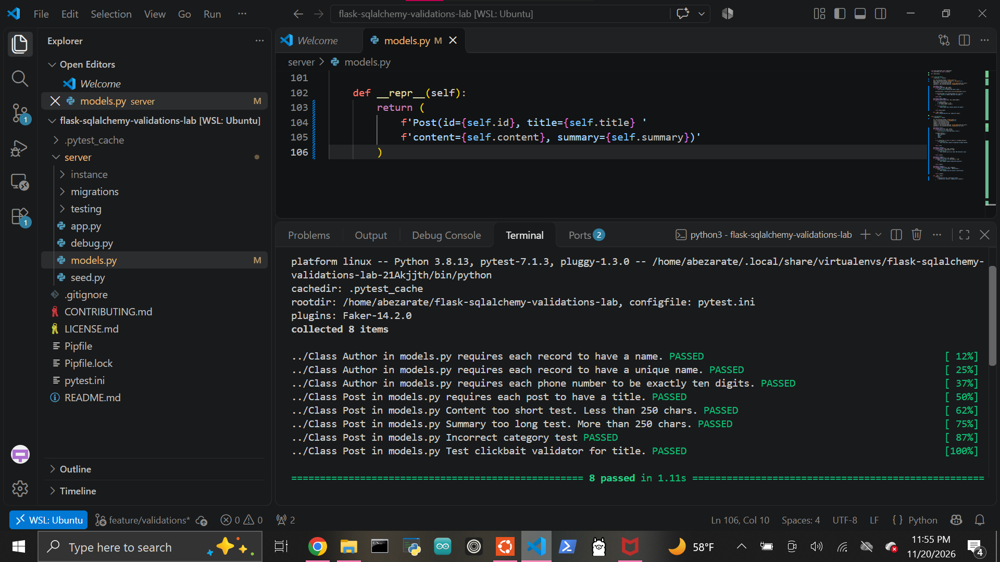

# Flask-SQLAlchemy Validations Lab

This project demonstrates model-level validation using Flask-SQLAlchemy and SQLAlchemy's `@validates()` decorator.

The application models blog Authors and Posts while enforcing business rules before invalid data can be stored in the database.

## Validation Rules

### Author

Each Author must meet the following requirements:

- `name` is required.
- `name` must be unique.
- `phone_number` must contain exactly 10 digits.

Invalid Author data raises a `ValueError`.

### Post

Each Post must meet the following requirements:

- `title` is required.
- `title` must contain at least one approved clickbait phrase:
  - `Won't Believe`
  - `Secret`
  - `Top`
  - `Guess`
- `content` must contain at least 250 characters.
- `summary` cannot exceed 250 characters.
- `category` must be either `Fiction` or `Non-Fiction`.

Invalid Post data raises a `ValueError`.

## Technologies

- Python 3.8.13
- Flask
- Flask-SQLAlchemy
- Flask-Migrate
- SQLAlchemy
- Pytest
- Faker
- SQLite

## Setup

Install the project dependencies and enter the virtual environment:

```bash
pipenv install
pipenv shell
```

Move into the server directory:

```bash
cd server
```

Configure Flask:

```bash
export FLASK_APP=app.py
export FLASK_RUN_PORT=5555
```

## Database Setup

This project already includes its database migration.

Apply the migration:

```bash
flask db upgrade
```

Seed the database:

```bash
python seed.py
```

## Run the Application

From the `server` directory:

```bash
flask run
```

The application runs on port `5555`.

## Testing

Run the full test suite:

```bash
pytest -v
```

The completed implementation passes all 8 tests covering:

- required Author names
- unique Author names
- 10-digit phone-number validation
- required Post titles
- minimum Post content length
- maximum Post summary length
- valid Post categories
- clickbait title validation

## Test Results

